# 🐧 The Definitive Visual Guide: Installing Ubuntu with balenaEtcher on your Windows Laptop (Safe Dual Boot)

> **💖 For my beautiful girlfriend:** I prepared this step-by-step guide especially for you with all my love, designed so that you can install **Ubuntu** on your **Windows** laptop completely stress-free, leaving behind all the errors and frustration you experienced with Rufus. Here you will learn how to revive your USB flash drive, flash it flawlessly with **balenaEtcher**, configure your BIOS boot settings, and set up a smooth **Dual Boot** so both operating systems coexist peacefully while keeping all your personal files 100% safe.

---

## 💡 What Exactly Are We Doing? It's Called DUAL BOOT (Dualboot)

What we are setting up on your laptop is technically called a **Dual Boot** (or *Dualboot* / dual startup):

* **Two operating systems on a single laptop:** This means your existing **Windows** and your brand-new **Ubuntu** will live peacefully side by side on your physical SSD/hard drive.
* **Windows will NOT be deleted:** You will not lose any of your programs, college assignments, pictures, or personal files. Both systems remain independent neighbors housed in separated disk partitions.
* **You choose where to go each time you turn on the computer:** Every time you press the power button, a clean startup screen (the GNU GRUB menu) will appear, giving you the freedom to choose:
  - 💼 **Windows:** For your everyday coursework, favorite applications, and familiar environment.
  - 🐧 **Ubuntu:** For coding, exploring Linux, practicing command line tools, and software development.

---

## 🛑 Step 0 Mandatory Precaution: Don't Forget to Back Up Your Files!

> [!CAUTION]
> ### 📁 The #1 Golden Rule of Computing:
> While this Dual Boot process is completely safe and specifically configured to preserve your Windows installation untouched, **the golden rule whenever modifying disk partitions is to create a backup copy of your important files**:
> 
> * **What to back up:** Your university homework, thesis/research papers, family photos, videos, and any irreplaceable files.
> * **Where to save them:** Upload them to cloud storage (**Google Drive, OneDrive, or Dropbox**) or copy them to an external hard drive / USB flash drive (different from the installer USB).
> 
> *Taking 5 minutes to back up your personal files will give you 100% peace of mind throughout the entire installation.*

---

## 📌 Important Note About the Photos in this Guide: Read this first!

> [!NOTE]
> ### 💡 Laptop and Screen Differences Between Ours:
> To document every single second of the process with 100% authentic, real-world screenshots and guide you safely, **I carried out the entire test installation on my personal laptop (a Lenovo where I already have Kali Linux)**.
> 
> Meanwhile, **you will be doing the installation on your Huawei laptop (where you have Windows)**.
> 
> For that reason:
> 1. In my photos, you will see the **Lenovo** logo or options mentioning *"Kali Linux"*.
> 2. On your screen, you will see the **Huawei** logo and the official option you must select:  
>    👉 **`Install Ubuntu alongside Windows Boot Manager`**.
> 3. In the BIOS section, I included the exact setup for your **Huawei** (featuring the blue *InsydeH2O* interface) as well as the photos of how I configured it on my Lenovo.
> 
> In every critical step, I added special callout boxes highlighting what you will see in Windows so you know with absolute certainty which button to click without any fear. Everything else is identical!

---

## 📑 Table of Contents

1. [What Exactly Are We Doing? It's Called DUAL BOOT (Dualboot)](#-what-exactly-are-we-doing-its-called-dual-boot-dualboot)
2. [Step 0 Mandatory Precaution: Don't Forget to Back Up Your Files!](#-step-0-mandatory-precaution-dont-forget-to-back-up-your-files)
3. [Important Note About the Photos in this Guide](#-important-note-about-the-photos-in-this-guide-read-this-first)
4. [What Went Wrong with Rufus and Why balenaEtcher Is the Fix](#-1-what-went-wrong-with-rufus-and-why-balenaetcher-is-the-fix)
5. [Pre-Requisite Check: Checking & Disabling BitLocker or Device Encryption](#-pre-requisite-check-checking--disabling-bitlocker-or-device-encryption)
6. [Phase 1: Reviving and Cleaning the USB Flash Drive in Windows (Diskpart)](#-phase-1-reviving-and-cleaning-the-usb-flash-drive-in-windows-diskpart)
7. [Phase 2: Downloading the Official Ubuntu LTS 64-bit ISO](#-phase-2-downloading-the-official-ubuntu-lts-64-bit-iso)
8. [Phase 3: Why balenaEtcher and Not Rufus? (Comparison)](#-phase-3-why-balenaetcher-and-not-rufus-comparison)
9. [Phase 4: Flawless USB Flashing with balenaEtcher](#-phase-4-flawless-usb-flashing-with-balenaetcher)
10. [Phase 5: BIOS Configuration & Resolving "Secure Boot"](#-phase-5-bios-configuration--resolving-secure-boot)
    - [Case A: InsydeH2O BIOS (YouTube Reference — Huawei MateBook)](#-case-a-insydeh2o-bios-insydeh2o-setup-utility--youtube-reference-example-for-huawei-matebook)
    - [Case B: Lenovo BIOS Setup Utility (Real Photos from my Laptop)](#-case-b-lenovo-bios-lenovo-setup-utility--real-photos-from-my-laptop)
11. [Phase 6: Booting from USB (F12 Boot Menu and GNU GRUB)](#-phase-6-booting-from-usb-f12-boot-menu-and-gnu-grub)
12. [Phase 7: The Ubuntu Graphical Installation Wizard (Step by Step)](#-phase-7-the-ubuntu-graphical-installation-wizard-step-by-step)
13. [Phase 8: The Most Critical Step! Dual Boot Alongside Windows](#-phase-8-the-most-critical-step-dual-boot-alongside-windows)
14. [Phase 9: Disk Space Allocation (The Slider)](#-phase-9-disk-space-allocation-the-slider)
15. [Phase 10: Security and Encryption Options](#-phase-10-security-and-encryption-options)
16. [Phase 11: Creating Your User Account](#-phase-11-creating-your-user-account)
17. [Phase 12: Timezone & Reviewing the Final Summary](#-phase-12-timezone--reviewing-the-final-summary)
18. [Phase 13: File Copy Progress & Safe Reboot](#-phase-13-file-copy-progress--safe-reboot)
19. [Phase 14: Your New Dual Boot: Choosing Between Ubuntu or Windows](#-phase-14-your-new-dual-boot-choosing-between-ubuntu-or-windows)
20. [Phase 15: First Steps & System Update in Ubuntu](#-phase-15-first-steps--system-update-in-ubuntu)
21. [Final Verification Checklist (Certificate of Success)](#-final-verification-checklist-certificate-of-success)

---

## 🧠 1. What Went Wrong with Rufus and Why balenaEtcher Is the Fix

When you tried creating the bootable installer with **Rufus** on your Windows laptop, several technical factors triggered a chain reaction that caused the installation to fail or caused your laptop to "bounce" straight back into Windows:

1. **The Trap of Rufus Advanced Settings:** Rufus prompts you with confusing technical choices regarding partition schemes (*GPT vs. MBR*), target systems (*UEFI vs. BIOS*), file systems (*FAT32 vs. NTFS*), and whether to write in *ISO Image Mode* or *DD Image Mode*. If any setting doesn't perfectly align with your modern UEFI motherboard, the EFI boot partition gets misconfigured or corrupted.
2. **Blocked Boot Signatures (Secure Boot):** When not written in pure bit-by-bit disk cloning mode (DD mode), your laptop's UEFI BIOS detected modified or unsigned bootloaders that it considered "unauthorized" by factory policy, blocking the boot sequence for security reasons.
3. **Immediate Boot Fallback:** Unable to boot the USB drive due to the security lock or damaged partition structure, your laptop did the only thing it was programmed to do to keep you safe: bypass the USB drive and boot straight into **Windows** as usual.
4. **The Solution with balenaEtcher:** **balenaEtcher** does not confuse you with dozens of technical drop-downs. It performs a **pure, bit-by-bit identical clone** (native raw DD mode) of the official Ubuntu image, preserving Canonical's official cryptographic UEFI signatures and performing a 100% byte-level checksum validation before finishing.

---

## 🛡️ Pre-Requisite Check: Checking & Disabling BitLocker or Device Encryption

> [!IMPORTANT]
> ### 🔍 Why this check is critical for your laptop and not for mine:
> - **On your Windows laptop (Windows + Ubuntu):** Checking drive encryption is a vital precaution before altering disk partitions. On many modern laptops running Windows 11 (such as Huawei, HP, Dell, Asus, or Lenovo models), **BitLocker** or **Device Encryption** comes enabled by default from the factory.
> - **On my Lenovo laptop (Kali Linux + Ubuntu):** BitLocker does not apply because there is no encrypted Windows partition present.

Before installing Ubuntu alongside Windows, it is essential to check whether your Windows system drive is encrypted and turn it off so Ubuntu can safely resize your partition.

### ❓ Why does this matter?
The Ubuntu installer cannot resize or write into an encrypted Windows NTFS partition. If BitLocker remains on, the installer will either fail to detect Windows (preventing the *"Install Ubuntu alongside Windows Boot Manager"* option from showing up) or refuse to shrink the drive.

### 🔍 How to check on Windows 11:
1. Open **Settings → Privacy & security → Device encryption**, if that option is visible.
2. Alternatively, type **Manage BitLocker** directly in the Windows Start menu search bar. Available options vary depending on your Windows edition (*Home* vs. *Pro*).
3. Check the encryption status. If it says **On** or shows a locked padlock, follow the steps below to disable it.

---

### 🔓 How to Disable BitLocker / Device Encryption in Windows (3 Methods)

You can turn off BitLocker through the modern **Settings app**, the classic **Control Panel**, or via **PowerShell / Command Prompt (Admin)**:

#### 🔹 Method 1: From Settings (Windows 11 Home / Device Encryption)
1. Press **`Win + I`** to open the Windows **Settings** app.
2. Go to **Privacy & security** → **Device encryption** *(Cifrado de dispositivo)*.
3. Toggle the switch to **`Off`** *(Desactivado)* and click **Turn off** to confirm.

#### 🔹 Method 2: From Control Panel (Windows 11 Pro, Enterprise, or Education)
1. Open the Start menu, type **`Manage BitLocker`** *(Administrar BitLocker)*, and press `Enter`.
2. Locate your encrypted drive (typically the **`C:`** drive).
3. Click **`Turn off BitLocker`** *(Desactivar BitLocker)* and confirm the prompt.
4. Wait for Windows to complete the background decryption process.

#### 🔹 Method 3: Using the Command Line (PowerShell or Command Prompt as Administrator)
1. Right-click the Windows Start button (`Win + X`) and choose **Terminal (Admin)** or **Command Prompt (Administrator)** / **PowerShell (Administrator)**.
2. Check your current encryption status by typing:
   ```cmd
   manage-bde -status
   ```
   *(Look for `Percentage Encrypted` and `Protection Status`).*
3. To disable BitLocker on a specific drive (for example, `C:`), execute:
   ```cmd
   manage-bde -off C:
   ```
   *(Alternatively, in PowerShell you can run the official cmdlet:* `Disable-BitLocker -MountPoint "C:"`*).*

> [!WARNING]
> ### ⏳ Important Decryption Notice:
> * Windows will begin decrypting your drive in the background. You can continue using your laptop normally while this process runs.
> * **DO NOT forcefully turn off or unplug your laptop during decryption.**
> * To check if it has finished, run `manage-bde -status` again until it shows **`Percentage Encrypted: 0.0%`** and **`Protection Status: Protection Off`**.
> * For advanced management cmdlets and parameters, refer to the [official Microsoft Learn BitLocker documentation](https://learn.microsoft.com/en-us/windows/security/operating-system-security/data-protection/bitlocker/).

---

### 🎥 Visual Video Tutorial:
If you would like to see the exact visual step-by-step process of turning off BitLocker, you can follow this video guide:
* 📺 **[Watch YouTube Tutorial: How to Turn Off BitLocker in Windows](https://www.youtube.com/watch?v=aWM9DguYRMw)**

---

### ⚠️ Essential Safety Recommendations:
- **Back up your important files:** Copy your university projects, photos, and essential documents to an external drive or cloud storage (Google Drive, OneDrive). A backup does not replace checking encryption, but it guarantees peace of mind against accidental partitioning mistakes.
- **Locate and safely store your 48-digit BitLocker recovery key:** You may need it if Windows prompts for access after bootloader modifications. Consult the [official Microsoft BitLocker support guide](https://support.microsoft.com/en-us/windows/finding-your-bitlocker-recovery-key-in-windows-6b71f327-020b-cc01-a035-109ec7031044).
- **Do not simply click "Suspend protection":** Suspending BitLocker **is not the same as decrypting the drive**. Ubuntu official documentation notes that for certain installer releases, suspending protection is insufficient for guided dual-boot installation; turning off device encryption and waiting for full decryption is required.
- **If you are unsure how to proceed:** Pause at this step and verify the encryption status calmly before continuing.

> [!CAUTION]
> **🛑 Golden Rule:** Never delete partitions or accept an option that erases Windows in an attempt to solve a disk detection problem.

---

## 🛠️ Phase 1: Reviving and Cleaning the USB Flash Drive in Windows (Diskpart)

Because the previous Rufus attempt left corrupted or partial partitions on the USB drive, we will wipe it completely clean and reformat it like new using Windows' built-in command-line tool: `diskpart`.

### Step 1.1: Open Terminal as Administrator
1. Right-click the Windows Start button or press the keyboard shortcut **`Windows + X`**.
2. From the pop-up menu, select **Terminal (Admin)** or **PowerShell (Administrator)**.
3. If Windows displays a User Account Control prompt asking for permission, click **Yes**.

<p align="center">
  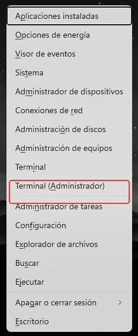
</p>

---

### Step 1.2: Launch Diskpart and List Available Disks
In the command window, type:
```cmd
diskpart
```
and press `Enter`.

<p align="center">
  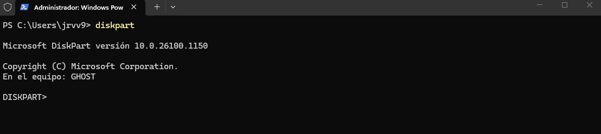
</p>

Next, type:
```cmd
list disk
```
and press `Enter`.

<p align="center">
  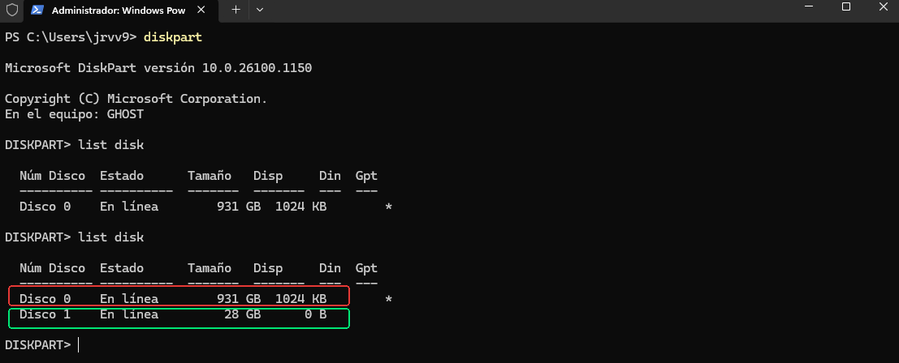
</p>

> [!IMPORTANT]
> ### 🛑 CRITICAL SAFETY RULE (Identify your USB drive by size):
> - **In the first attempt in the screenshot:** Only `Disk 0` appeared (the laptop's 931 GB internal hard drive). If this happens to you, Windows **has not recognized your USB drive yet**. Unplug it, firmly plug it into another USB port, and type `list disk` again.
> - **In the second attempt:** Once properly connected, **`Disk 1` with 28 GB (green box)** appears. That is your USB flash drive!
> 
> 🚨 **CRITICAL WARNING:** Never select **Disk 0 (red box)**, because that is your main Windows hard drive! Always select the disk number that matches your USB drive's capacity (in this example, **Disk 1**).

---

### Step 1.3: Select and Clean the USB Drive
1. Select your USB drive by its number (replace `1` if your USB has a different number on your system):
```cmd
select disk 1
```
*(Windows will respond: `"Disk 1 is now the selected disk"` - cyan box).*

2. Run the deep wipe command to eradicate all corrupted partition tables left behind by Rufus:
```cmd
clean
```
*(Windows will respond: `"DiskPart succeeded in cleaning the disk"` - green box).*

<p align="center">
  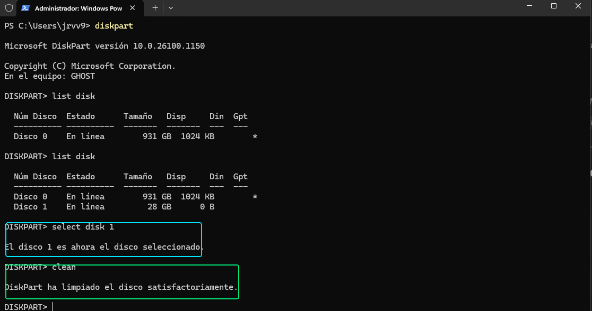
</p>

---

### Step 1.4: Rebuild the Partition and Format
Type these commands one after another, pressing `Enter` after each:

```cmd
create partition primary
select partition 1
active
format fs=fat32 quick
assign
exit
```

<p align="center">
  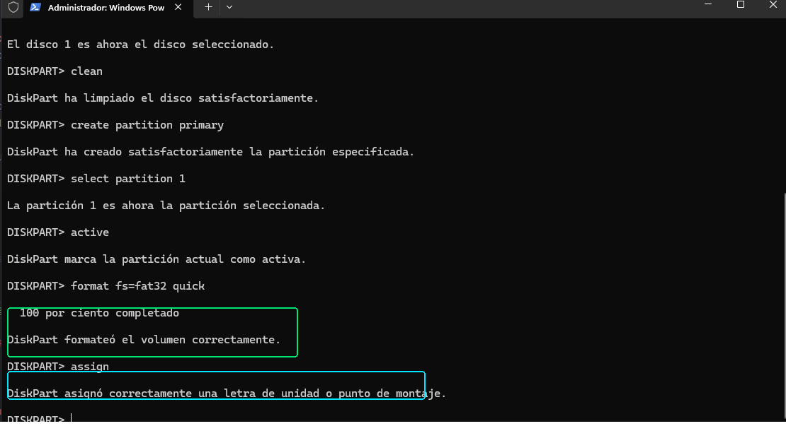
</p>

> [!TIP]
> ### 🎉 Your USB Flash Drive is Back to Life!
> - **`format fs=fat32 quick` (green box):** Restored the USB drive into a clean, healthy, blank slate ready to receive any operating system.
> - **`assign` (cyan box):** Assigned a fresh drive letter in Windows. At this exact moment, you will hear the Windows *"device connected"* chime, and your drive will reappear clean and empty in File Explorer (*This PC*).

To close the console window completely, type `exit` one more time:

<p align="center">
  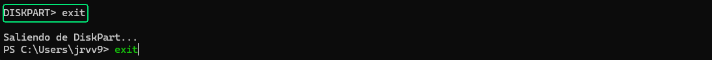
</p>

---

## 📥 Phase 2: Downloading the Official Ubuntu LTS 64-bit ISO

To ensure that no file has been altered or damaged, **we download the official image directly from Canonical's servers**:

### Step 2.1: Visit the Official Ubuntu Download Page
Open your web browser and go to:
* 🌐 **[ubuntu.com/download/desktop](https://ubuntu.com/download/desktop)**

### Step 2.2: Choose the Correct Architecture (Very Important!)
On the web page, you will see two download buttons. Pay close attention:

1. **✅ `Intel or AMD 64-bit architecture` -> "Download 5.9GB" Button (THIS IS THE ONE YOU MUST CHOOSE):**
   * 99% of laptops in everyday use (powered by **Intel Core i3/i5/i7, Celeron** or **AMD Ryzen** processors, including your laptop) use this standard architecture.
   * **This is the only button you should click.**

2. **❌ `ARM 64-bit architecture` -> "Download 3.9GB" Button (DO NOT CHOOSE):**
   * This is exclusively for specialized ARM chips (such as Qualcomm Snapdragon X Elite or Raspberry Pi boards). If you download this, your laptop will not be able to boot it.

> [!NOTE]
> **What does LTS mean?**  
> You will see the letters **LTS** (*Long Term Support*). This means it is the enterprise-grade, rock-solid stable version designed for daily productivity, featuring 5 years of guaranteed official security updates without experimental changes that could disrupt your bootloader.

<p align="center">
  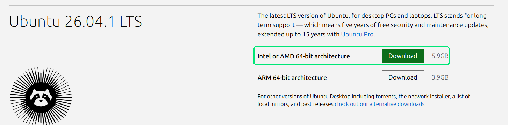
</p>

---

### Step 2.3: Monitor the Download in Your Browser
Clicking the green download button will start the file transfer automatically:

<p align="center">
  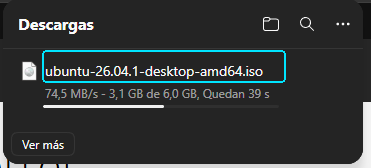
</p>

* **Verify the filename:** It will be named something like `ubuntu-26.04.1-desktop-amd64.iso` (or a similar `desktop-amd64.iso` release).
* **Be patient:** The ISO file is approximately 6 GB in size. Make sure it finishes 100% in your **Downloads** folder before proceeding.

---

## ⚖️ Phase 3: Why balenaEtcher and Not Rufus? (Comparison)

| Feature | With Rufus (Why you had issues) | With balenaEtcher (Why it will succeed now) |
| :--- | :--- | :--- |
| **User Experience** | Confusing menus (GPT vs. MBR, FAT32 vs. NTFS, cluster size, ISO vs DD). | **3 clear visual clicks.** Zero confusing options. |
| **Flashing Method** | By default unpacks files; altering a setting breaks UEFI booting. | **Pure raw bit-by-bit cloning (DD Mode)** automatically. |
| **UEFI Signatures** | Can create custom boot loaders rejected by BIOS security policies. | Preserves 100% of Canonical's official cryptographic signatures. |
| **Integrity Check** | Optional and hidden in checkboxes (rarely used). | **Mandatory automated checksum validation** to guarantee 0 errors. |

---

## 🚀 Phase 4: Flawless USB Flashing with balenaEtcher

### Step 4.1: Download balenaEtcher
Download the free installer from the official website:
* 🌐 **[etcher.balena.io](https://etcher.balena.io/)** (Choose *Etcher for Windows Installer* and run the installer).

---

### Step 4.2: The 3 Clicks of Flashing
Plug in your freshly cleaned USB flash drive and open **balenaEtcher**:

<p align="center">
  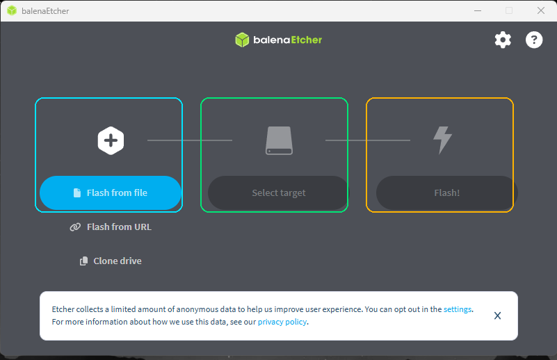
</p>

1. **🟦 Click 1 (`Flash from file` - cyan box):** Click and browse your *Downloads* folder to select the Ubuntu `.iso` file you just downloaded.
2. **🟩 Click 2 (`Select target` - green box):** Click and select your USB drive (the ~28 to 32 GB drive).
3. Once both are selected, the interface will look like this:

<p align="center">
  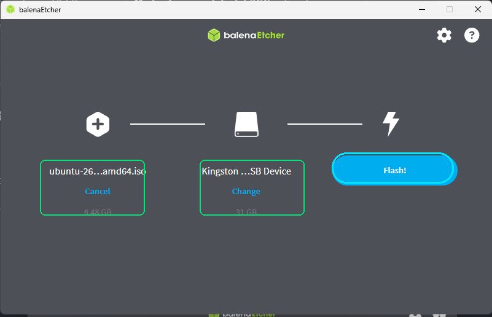
</p>

4. **🟧 Click 3 (`Flash!` - glowing blue box):** Click **Flash!** to start writing. If Windows asks for administrator permission, click **Yes**.

---

### Step 4.3: Flashing and Verification Process
balenaEtcher will now work automatically in two distinct phases:

<p align="center">
  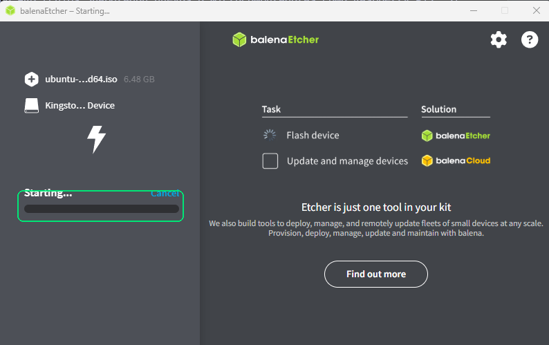
</p>

* First, you will see **Flashing...** (writing the raw Ubuntu image onto your drive).
* Next, you will see **Validating...** (verifying every single byte to ensure no corrupted files).
* Within a few minutes, you will see the bright green notice: **Flash Complete!**. That's it! You can safely close balenaEtcher.

---

> [!WARNING]
> ### 🚨 RED ALERT! The Windows Trap: "You need to format the disk before you can use it"
> As soon as balenaEtcher finishes flashing, Windows will detect Linux filesystem partitions that it natively cannot read. Instantly, Windows will pop up this dialog box:
> 
> <p align="center">
>   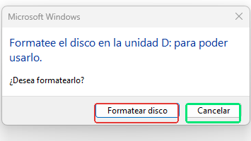
> </p>
> 
> * **🛑 Why does it say "The disk is write-protected" if you try to format it?**  
>   This is actually a fantastic safeguard! balenaEtcher and Ubuntu intentionally lock the partition in read-only mode **specifically to stop Windows from damaging the installer you just created**.  
> * **✅ What should you do?**  
>   Firmly click **`Cancel` (green box)** or close the window by clicking the `X`. **NEVER agree to format it**, because doing so would wipe Ubuntu and force you to start all over again.

---

### ❓ Why do two drives (`D:` and `E:`) now appear in "This PC"?
If you open File Explorer, you will notice that your single physical USB stick is now displayed as two separate drive letters:

<p align="center">
  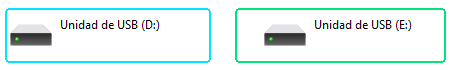
</p>

* **🟦 Drive D: (cyan box - Ubuntu OS installer):** Contains the complete compressed operating system (the desktop environment, utilities, and installation packages).
* **🟩 Drive E: (green box - EFI Boot Partition):** Contains the digital "UEFI boot key" with Canonical's official cryptographic certificates, enabling your laptop to boot into Linux.
* Together, these two partitions make up your perfect bootable drive. You are now ready to configure your BIOS!

---

## 🛡️ Phase 5: BIOS Configuration & Resolving "Secure Boot"

To allow your laptop to boot from the USB drive rather than loading Windows directly, we need to enter your computer's BIOS / UEFI settings.

### ⌨️ Which Key to Press to Enter BIOS by Laptop Brand?
With your laptop completely powered off, press the power button and immediately press the corresponding key repeatedly:

| Laptop Brand | Key to Enter BIOS | Quick Boot Menu Key |
| :--- | :--- | :--- |
| **Huawei / Honor** | `F2` (or `Fn + F2`) | `F12` |
| **HP** | `F10` or `Esc` | `F9` |
| **ASUS** | `F2` or `Delete` | `F8` or `Esc` |
| **Lenovo** | `F2` (or `Fn + F2`) | `F12` (or `Fn + F12`) |
| **Dell** | `F2` | `F12` |
| **Acer** | `F2` | `F12` |

---

### 💻 Case A: InsydeH2O BIOS (`InsydeH2O Setup Utility` — YouTube Reference Example for Huawei MateBook)

> [!NOTE]
> **🎬 About this screenshot:**  
> This visual reference was captured from a YouTube demonstration on a **Huawei MateBook**. Many modern Windows laptops (Huawei, Acer, certain HP models, etc.) use this exact **InsydeH2O** BIOS layout, characterized by a single blue screen with a vertical list. If your laptop's BIOS looks like this, follow these steps:

<p align="center">
  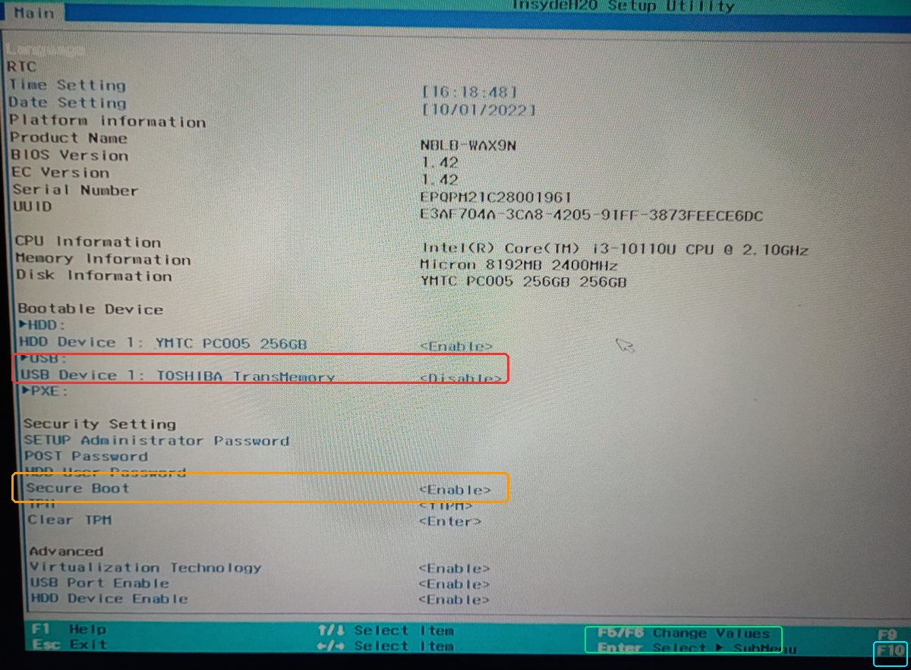
</p>

#### 🔍 The 2 Culprits Preventing Boot in this BIOS:
1. **🚨 Culprit 1: USB booting disabled by default (Red box):**
   * Under the **`Bootable Device`** section, the line:  
     `USB Device 1: TOSHIBA TransMemory   <Disable>`  
     is set to **`<Disable>`**. The laptop has a strict factory rule **forbidding booting from any USB device**.
2. **⚠️ Culprit 2: Secure Boot enabled (Orange box):**
   * Under the **`Security Setting`** section, the line:  
     `Secure Boot   <Enable>`  
     blocks any non-Windows external operating system.

#### 🛠️ Step-by-Step Fix in InsydeH2O BIOS:
1. Power on your laptop and press `F2` repeatedly until the BIOS screen appears.
2. Use the arrow keys `↑ / ↓` to move down to your USB flash drive line:  
   `USB Device 1: ... <Disable>`
3. Press **`F5` or `F6`** (or press `Enter`) to toggle the value from `<Disable>` to **`<Enable>`** *(green box)*.
4. Use the arrow keys to scroll down to **`Secure Boot`**.
5. Press **`F5` or `F6`** to toggle from `<Enable>` to **`<Disable>`**.
6. **Save Changes and Exit:** Press **`F10` (cyan box in the lower corner)** to save and exit (*Save and Exit*). Confirm by pressing `Enter`.

---

### 💻 Case B: Lenovo BIOS (`Lenovo Setup Utility` — Real Photos from my Laptop)

In the photos I took on my Lenovo laptop, the BIOS interface is organized into horizontal tabs (`Information`, `Configuration`, `Security`, `Boot`, `Exit`). Here is how I configured it:

<p align="center">
  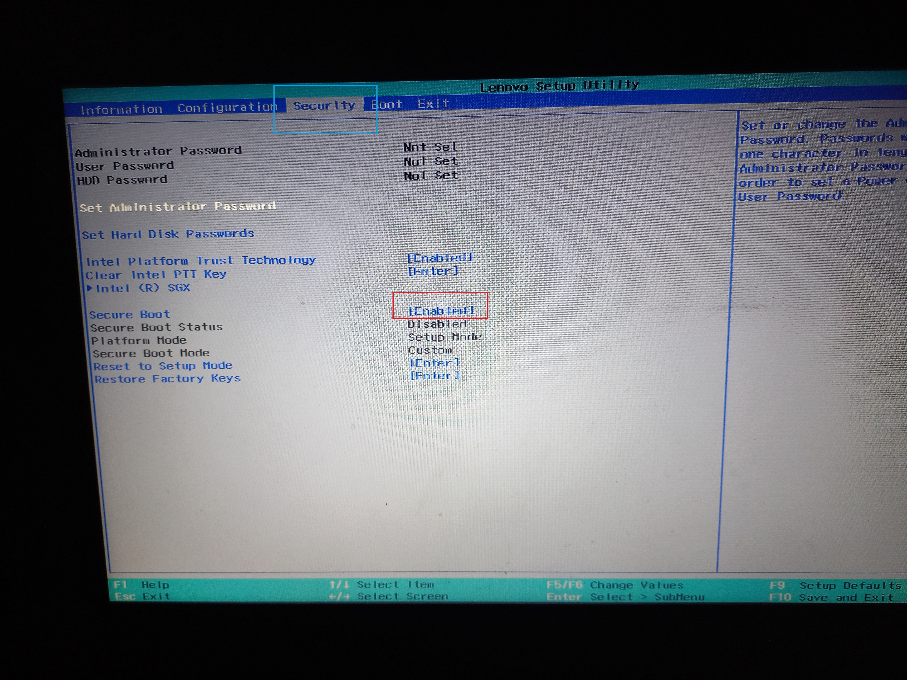
</p>

1. I entered the BIOS using **`Fn + F2`**.
2. I used the right arrow key `→` to navigate to the **`Security`** tab *(cyan box)*.
3. I moved down to **`Secure Boot`** (which was set to `[Enabled]`, *red box*) and switched it to **`[Disabled]`** *(green box)*:

<p align="center">
  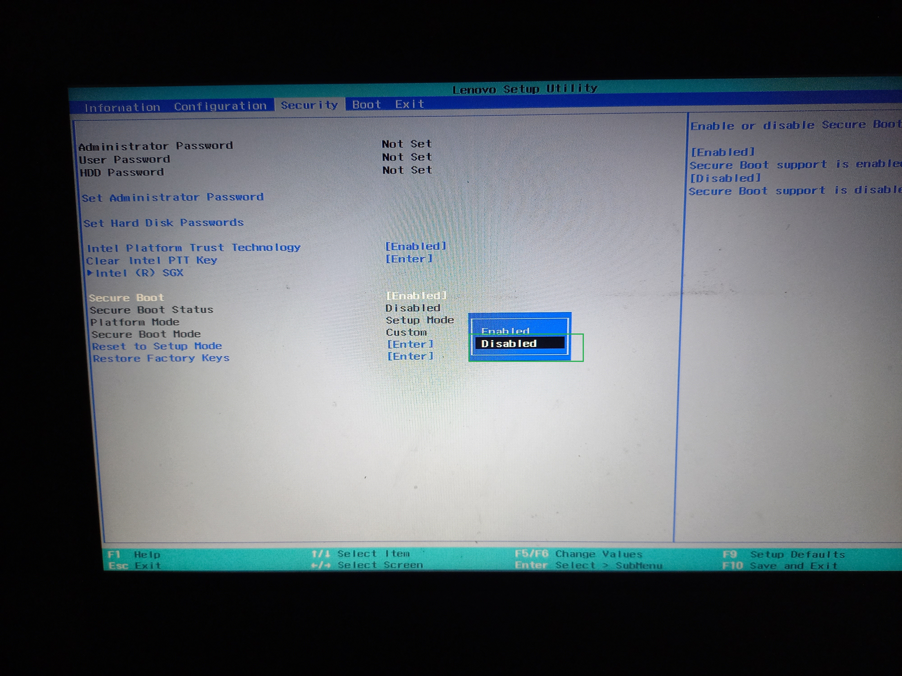
</p>

4. I pressed **`F10`** to save changes (*Save configuration changes and exit now?*) and selected **`[Yes]`** *(green box)*:

<p align="center">
  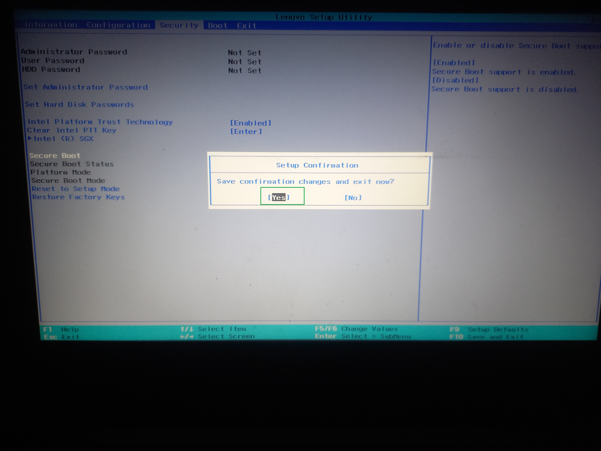
</p>

> [!WARNING]
> ### 🚨 Common Trap When Saving on Lenovo: Avoid Pressing F9
> If you accidentally press **`F9`** instead of `F10`, this prompt appears:
> 
> <p align="center">
>   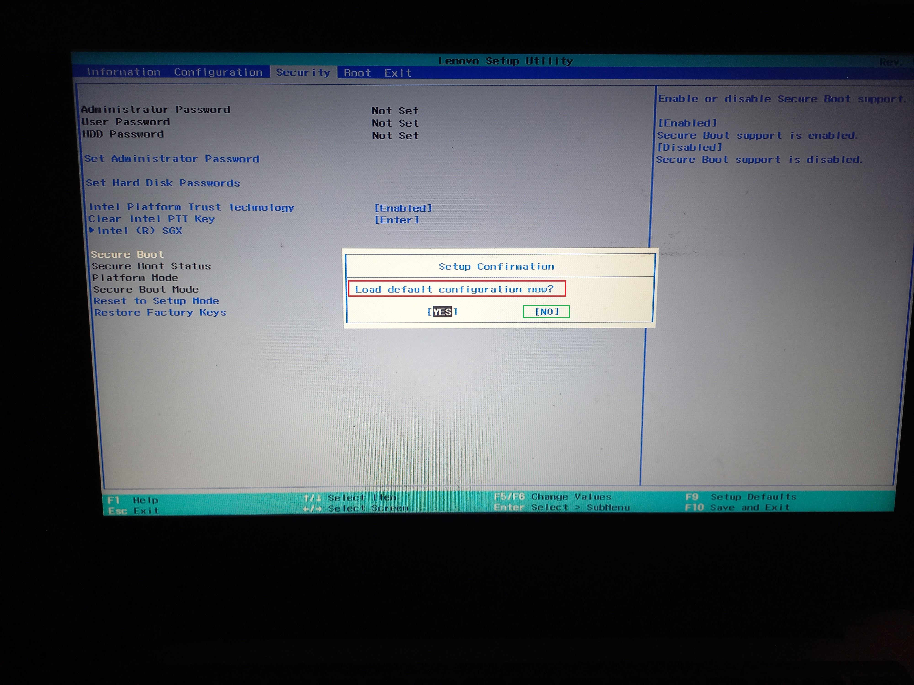
> </p>
> 
> `F9` means *Load Default Settings*. If the red alert box appears (*"Load default configuration now?"*), **DO NOT press `[YES]`**, because it will revert your changes and turn Secure Boot back on! Always select **`[NO]`** *(green box)*, and then press **`F10`**.

---

## 💻 Phase 6: Booting from USB (F12 Boot Menu and GNU GRUB)

1. Plug your USB flash drive into the laptop while powered off.
2. Turn it on and immediately press the **`F12`** key repeatedly (or **`Fn + F12`** on laptops with inverted function keys) until the **Boot Manager** device list appears.
3. Use the arrow keys `↑ / ↓` to select your USB drive (it may appear under your drive brand such as *Kingston*, *Toshiba*, *SanDisk*, or the generic label *Linpus lite*) and press **`Enter`**.
4. You will immediately see the official **GNU GRUB** bootloader screen:

<p align="center">
  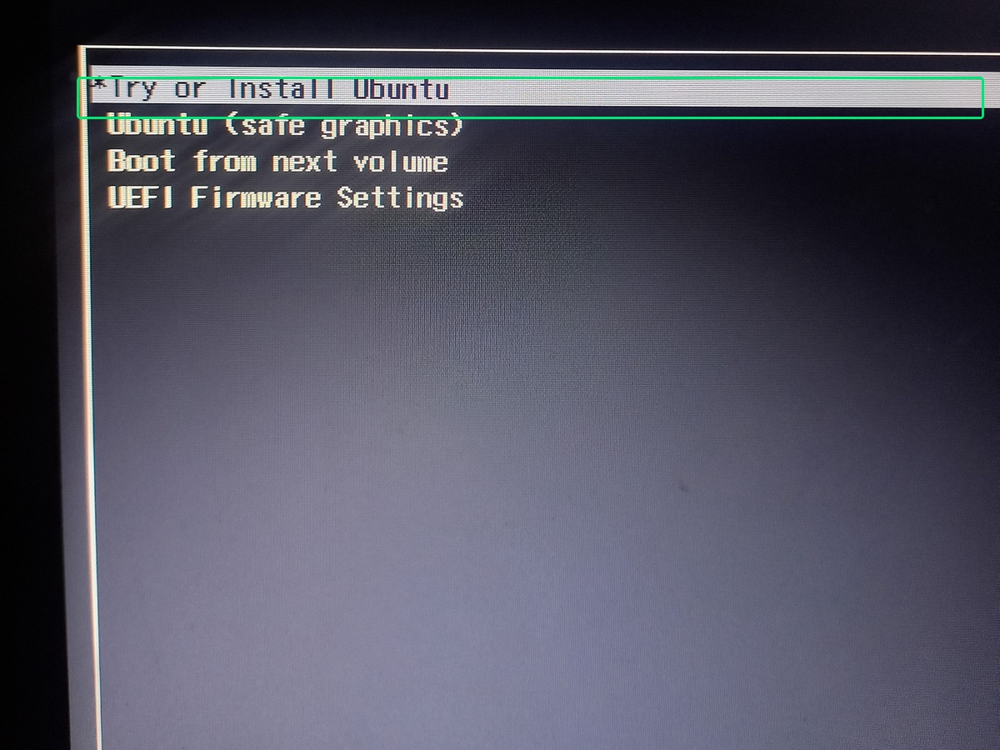
</p>

* The first option is selected by default: **`*Try or Install Ubuntu`** *(green box)*.
* Press **`Enter`** (or simply wait 5 seconds for it to proceed automatically).

---

### ⏳ The Splash Screen: Why does the laptop brand logo appear?
Upon pressing `Enter`, the screen will turn black, and you will see your laptop's brand logo with the orange Ubuntu logo at the bottom:

<p align="center">
  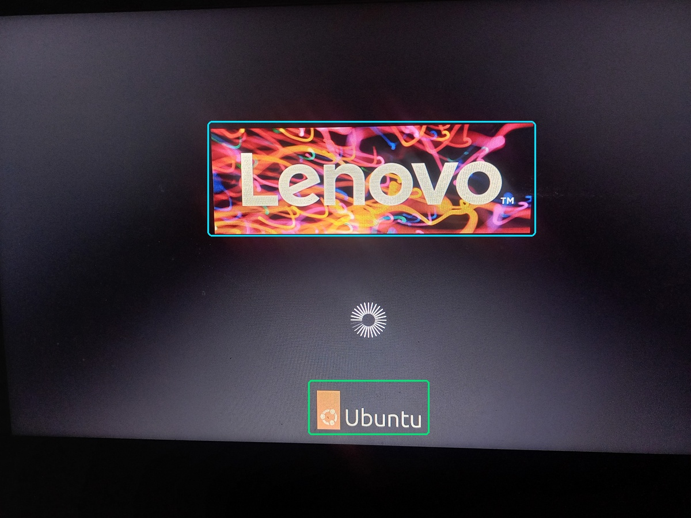
</p>

* **In my photo:** The **Lenovo** logo appears because I used my personal laptop.
* **On your laptop:** You will see your manufacturer logo (such as **Huawei**) with **Ubuntu** underneath.
* **What does this mean?** This is the best possible sign: it confirms that the installer successfully loaded all graphics drivers for your laptop hardware.

---

## 🌐 Phase 7: The Ubuntu Graphical Installation Wizard (Step by Step)

After a few seconds of loading, the purple desktop and graphical installer will appear. Let's walk through each screen:

### Step 7.1: Welcome & Language Selection
On the **`Welcome to Ubuntu`** screen:

<p align="center">
  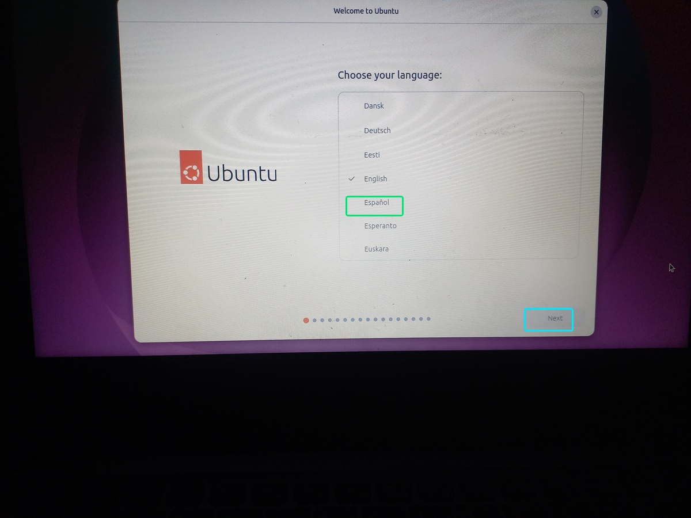
</p>

1. Scroll down the list and select your preferred language (e.g., **`English`** or **`Español`** - *green box*).
2. Click the **`Next`** button in the lower-right corner *(cyan box)*.

> [!TIP]
> **💡 Help Tip:**  
> You can choose **English** or **Spanish** according to what feels most comfortable for you to clearly read the partition and disk summaries.

---

### Step 7.2: Accessibility Options
An introductory screen for accessibility settings (vision, hearing, zooming) will appear:

<p align="center">
  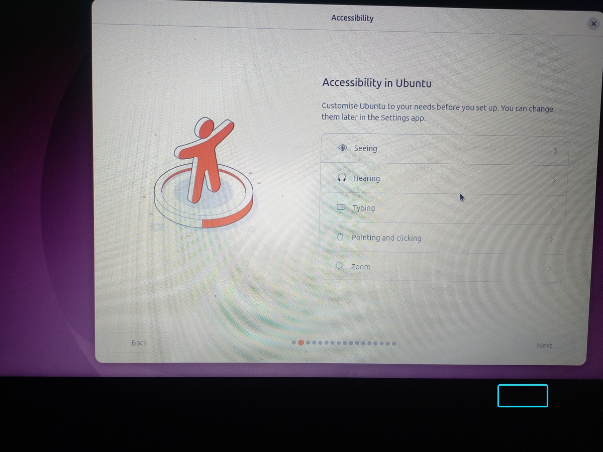
</p>

* You do not need to change anything here unless desired.
* Simply click **`Next`** *(cyan box)* to continue.

---

### Step 7.3: Keyboard Layout
Here you configure your physical keyboard layout so every key matches what you type:

<p align="center">
  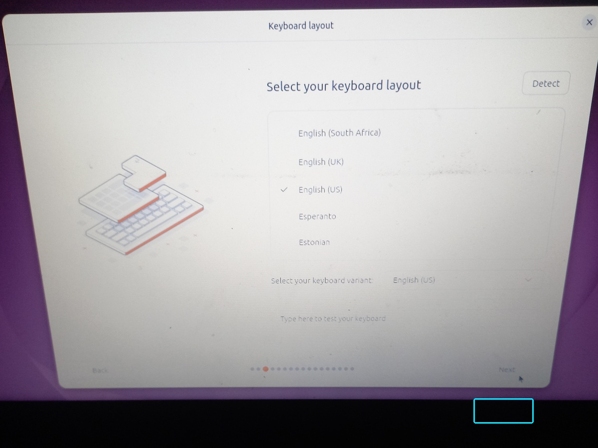
</p>

1. Select your keyboard layout (e.g., **`Spanish (Latin American)`** or **`English (US)`** depending on your laptop keyboard).
2. **Mandatory test:** Click in the white test box and type:
   - Special symbols like `@`, `-`, `_`, `/`
   - Accents or language-specific keys
3. Once the characters match your physical keyboard, click **`Next`** *(cyan box)*.

---

### Step 7.4: Internet Connection (Wi-Fi)
The installer will scan for nearby wireless networks:

<p align="center">
  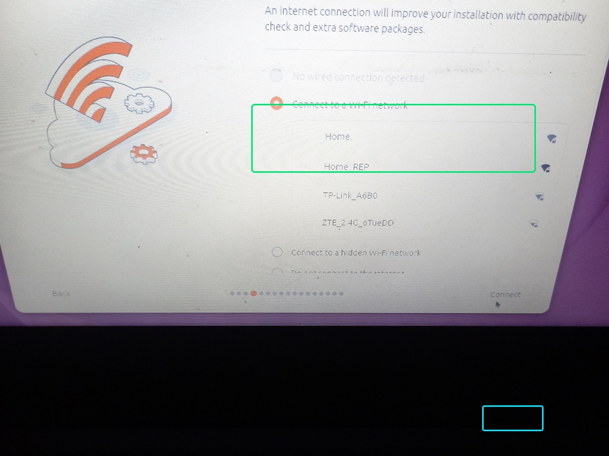
</p>

1. Select your home Wi-Fi network.
2. Enter your password and click **Connect**.
3. Click **`Next`** *(cyan box)*.  
   *(Connecting to the internet allows Ubuntu to download the latest hardware drivers and packages during setup).*

---

### Step 7.5: What do you want to do with Ubuntu?
A screen will ask: *"What do you want to do with Ubuntu?"*:

<p align="center">
  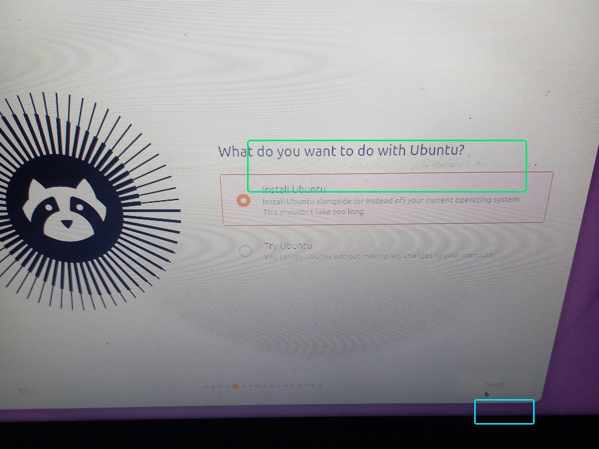
</p>

* Choose: **`Install Ubuntu`** *(Install Ubuntu alongside or instead of your current operating system - green box)*.
* Click **`Next`** *(cyan box)*.

---

### Step 7.6: Installation Type (`Interactive installation`)
Ubuntu will ask how you want to perform the setup:

<p align="center">
  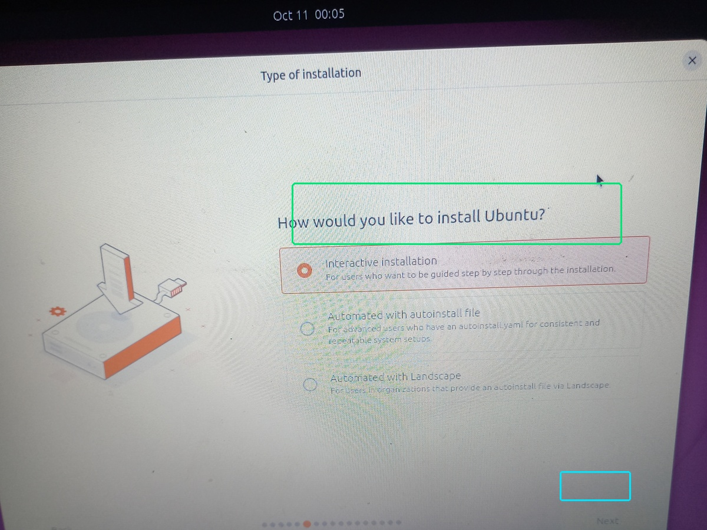
</p>

* ✅ Select **`Interactive installation`** *(green box)*.  
  This option gives you full visual review and control over every screen.
* Click **`Next`** *(cyan box)*.

---

### Step 7.7: Optimization and Third-Party Software
On the *"Optimise your computer / Install recommended proprietary software?"* screen:

<p align="center">
  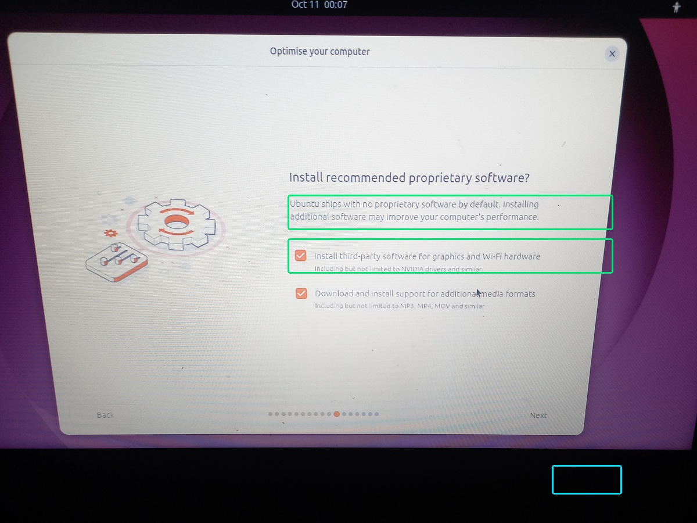
</p>

1. ☑️ **`Install third-party software for graphics and Wi-Fi hardware` (Green box):**  
   **Always check this box!** It installs proprietary drivers so your Wi-Fi card and graphics run at top performance.
2. ☑️ **`Download and install support for additional media formats`:**  
   Check this box so you can play music and video formats (MP4, MP3) smoothly right out of the box.
3. Click **`Next`** *(cyan box)*.

---

## 🚨 Phase 8: The Most Critical Step! Dual Boot Alongside Windows

> [!CAUTION]
> ### 🛑 MAXIMUM ATTENTION: The most important screen of the entire installation
> The installer asks: **`How do you want to install Ubuntu?`**.  
> Read this section carefully to understand exactly what you will see on your screen:

<p align="center">
  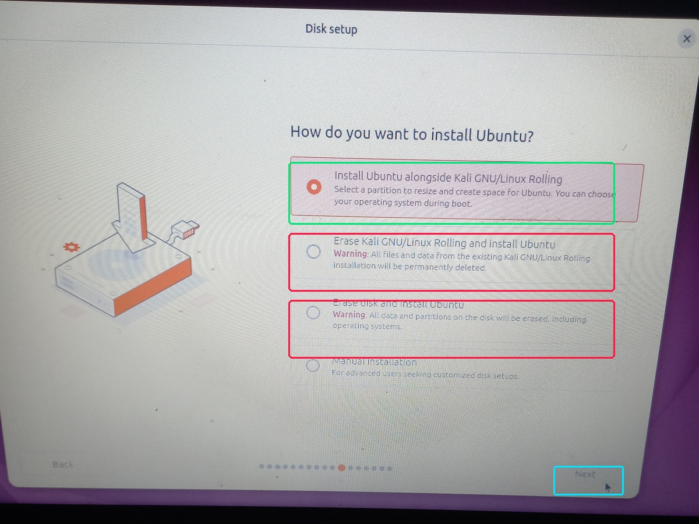
</p>

### 🔍 The Key Difference Between My Photo and Your Screen:
* **In my photo (above):** You see:  
  `Install Ubuntu alongside Kali GNU/Linux Rolling` *(green box)*  
  because my laptop already had Kali Linux installed.
* **On YOUR screen (on your Windows laptop):** You will see this exact option:  
  👉 **`Install Ubuntu alongside Windows Boot Manager`**.

---

### 📋 Which Option to Pick and Which to AVOID:
1. ✅ **`Install Ubuntu alongside Windows Boot Manager` (THIS IS THE ONLY ONE YOU MUST SELECT):**  
   * **THIS IS YOUR OPTION!** This is where you configure your **Dual Boot (Dualboot)**. It allows Ubuntu and Windows to live side by side on the same disk. It keeps your Windows partition completely untouched: no personal files, photos, or programs are deleted.
2. 🛑 **`Erase Windows Boot Manager and install Ubuntu` (DO NOT SELECT! - Middle red box):**  
   * This would erase your Windows installation to leave only Ubuntu.
3. 🛑 **`Erase disk and install Ubuntu` (MAXIMUM DANGER! - Bottom red box):**  
   * This wipes the entire hard drive. **Never select this option.**

Once you have selected **alongside Windows Boot Manager**, click **`Next`** *(cyan box)*.

---

## ⚖️ Phase 9: Disk Space Allocation (The Slider)

After selecting the *alongside* option, you will see the **`Choose where to install Ubuntu`** screen with an interactive partition slider:

<p align="center">
  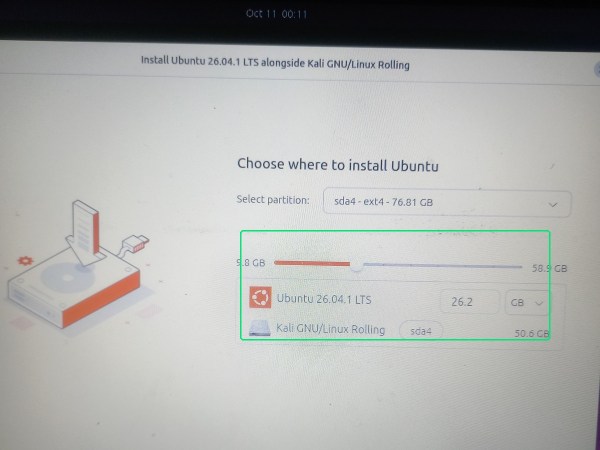
</p>

### 📐 How to Divide Your Hard Drive Space:
* **In my photo:** You see the drive shared between Ubuntu and Kali.
* **On your laptop:** You will see the drive shared between **Ubuntu** and your **Windows** system.
* **How to use the slider:** Click and hold the center divider handle with your mouse and drag it left or right:
  - **Recommended space for Ubuntu:** Allocate between **40 GB and 70 GB** (plenty of room for the OS, coding tools, study environments, and files).
  - **Space for Windows:** Make sure to leave comfortable free space on your Windows side for its normal updates and tasks.
* Once satisfied with the balance, click **`Next`** *(cyan box)*.

---

## 🔒 Phase 10: Security and Encryption Options

The **`Encryption and file system`** screen will appear:

<p align="center">
  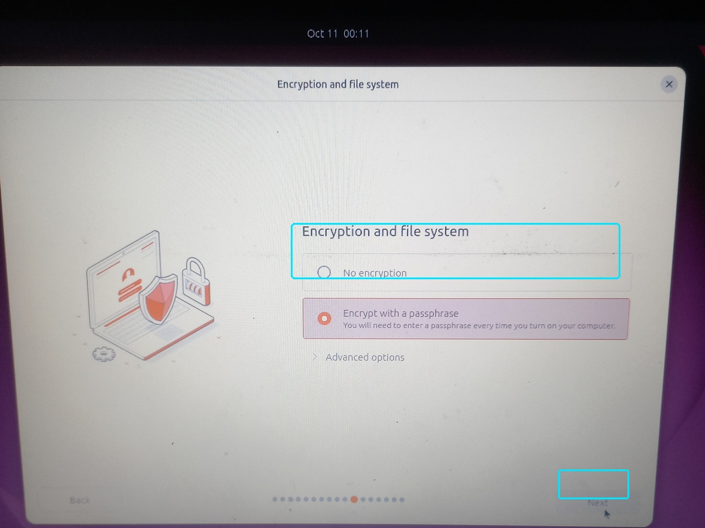
</p>

* In a Dual Boot setup alongside Windows, the recommended setting is:  
  ⚪ **`No encryption`**.  
  *(Encrypting the partition introduces additional pre-boot password prompts that can cause boot conflicts with the Windows Boot Manager).*
* Click **`Next`** *(cyan box)*.

---

## 👤 Phase 11: Creating Your User Account

On the **`Create your account`** screen, enter your personal details to set up your login credentials:

<p align="center">
  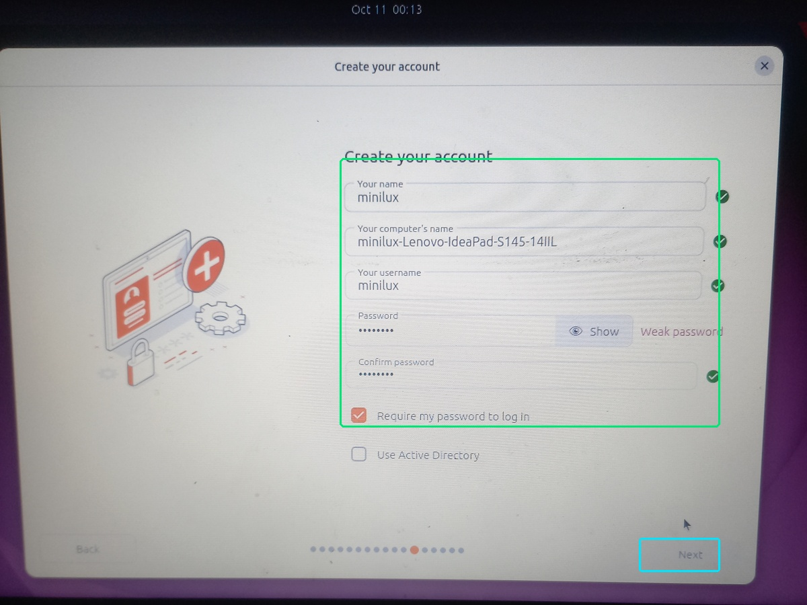
</p>

### ✍️ Guide to Filling the Form Fields:
1. **Your name:** Your real name (e.g., `Charlotte` or `钱奕彤`).
2. **Your computer's name:** The hostname your laptop uses on the network (e.g., `charlotte-matebook` or `matebook-ubuntu`). Use lowercase letters and hyphens without spaces.
3. **Pick a username:** The technical username for your profile and home directory (`/home/username`). Use **lowercase letters, no spaces or special characters** (e.g., `charlotte`).
4. **Choose a password and Confirm your password:**  
   > [!IMPORTANT]
   > This password will be your administrative master key (**`sudo`**). You will need it whenever you install applications or make system changes. Pick a password you will remember easily!
5. **Login behavior:** Select **`Require my password to log in`** for privacy and security.
6. Click **`Next`** *(cyan box)*.

---

## 🕒 Phase 12: Timezone & Reviewing the Final Summary

### 12.1. Timezone Configuration
* On the world map, click on your location or type in the search box: **`Lima`** (or your city).
* The timezone should reflect your local time (e.g., **`America/Lima` (UTC-05:00)**).
* *(Setting the correct time prevents HTTPS security certificate errors when browsing the web).*
* Click **Next**.

### 12.2. Final Summary (The Point of No Return)
A confirmation screen will appear titled:  
`Ready to install / Write changes to disk?`

* **Up to this exact second, your hard drive has NOT been touched.** If you turned off the laptop right now, everything in Windows would remain exactly as before.
* Review the summary to confirm that it shows the **resizing** of your Windows partition and the creation of a new `ext4` partition for Ubuntu.
* When you are ready and confident, click **`Install`**. From this moment on, the magic begins!

---

## ⏳ Phase 13: File Copy Progress & Safe Reboot

The installer will copy system files to your hard drive while displaying an introduction slideshow highlighting Ubuntu features:

<p align="center">
  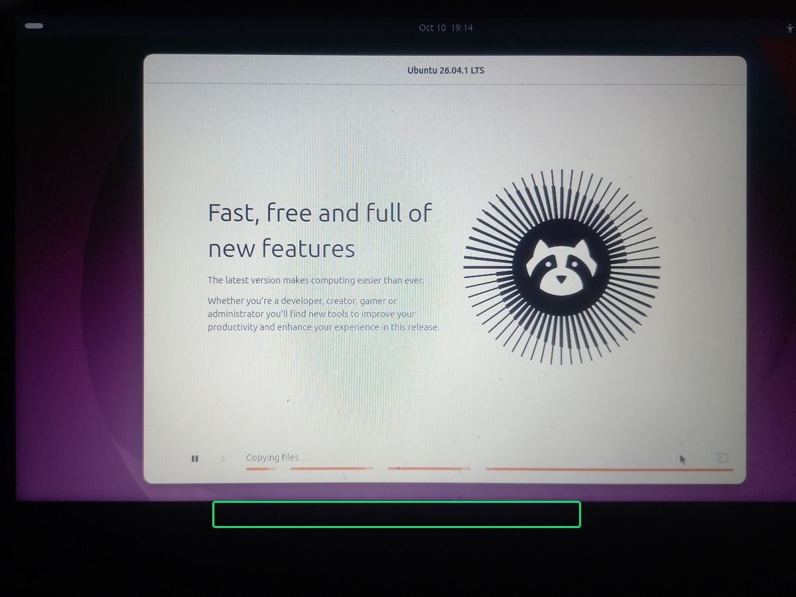
</p>

> [!WARNING]
> * **Keep your laptop plugged into its power charger:** Do not let the battery run out mid-installation.
> * **Do not unplug the USB drive:** Keep it connected while the progress bar is moving.

### The Reboot Moment:
When file copying finishes, a dialog will appear saying:  
`Installation complete: You can restart your computer to use the new installation.`

1. Click **`Restart Now`**.
2. The screen will turn black and display white text stating:
   ```text
   Please remove the installation medium, then press ENTER:
   ```
3. **Crucial step:** Gently pull your USB flash drive out of the laptop port, and then press **`Enter`**.

---

## 🐧 Phase 14: Your New Dual Boot: Choosing Between Ubuntu or Windows

From now on, every time you power on your laptop, the **GNU GRUB Menu** screen will appear:

```text
                       GNU GRUB version 2.12
 -----------------------------------------------------------------
  *Ubuntu
   Advanced options for Ubuntu
   Windows Boot Manager (on /dev/nvme0n1p1)
   UEFI Firmware Settings
 -----------------------------------------------------------------
   Use the ^ and v keys to select which entry is highlighted.
   Press enter to boot the selected OS.
```

* **To boot into Ubuntu:** Press `Enter` on the first option (**`Ubuntu`**).
* **To boot into your regular Windows:** Use the down arrow key `↓` to highlight:  
  👉 **`Windows Boot Manager`** and press `Enter`. You will enter your familiar Windows desktop with all your files, software, and pictures completely intact.

> [!TIP]
> **❓ What if turning on your laptop boots straight into Windows without showing this menu?**  
> Don't worry! This simply means your BIOS prioritized Windows over Ubuntu. Power on the laptop, press `F2` to enter BIOS, navigate to **Boot Order**, move **`ubuntu`** to the first priority above *Windows Boot Manager*, and save with `F10`. The GRUB menu will now appear every time.

---

## 🚀 Phase 15: First Steps & System Update in Ubuntu

### 15.1. The Welcome Tour
When you log into Ubuntu for the first time, a quick setup wizard will welcome you:
* **Ubuntu Pro:** Click **`Skip`**.
* **Help improve Ubuntu:** You can select *No, don't send system info*.
* **Location Services:** You can leave this off.
* Done! You are now in your brand-new Ubuntu desktop.

---

### 15.2. Your First System Update in Terminal
Let's synchronize all applications and drivers with Canonical's official repositories:

1. Open the terminal using the keyboard shortcut:  
   `Ctrl + Alt + T`
2. Type the following command and press `Enter`:
   ```bash
   sudo apt update && sudo apt upgrade -y
   ```
3. The terminal will ask for your password (the one you chose during installation).
   > [!NOTE]
   > For security reasons in Linux, **no asterisks, dots, or characters will appear on screen as you type your password in the terminal**. This is completely normal. Type your password confidently and press `Enter`.
4. The system will download and install all official security updates.

---

## 🏆 Final Verification Checklist (Certificate of Success)

Check off each item to confirm that your installation was a total success:

- [ ] Backup copy of important personal files (homework, photos, projects) safely created before starting.
- [ ] USB flash drive cleanly restored with `diskpart` in Windows.
- [ ] Official 64-bit (Intel/AMD) Ubuntu LTS ISO downloaded.
- [ ] USB drive flashed without errors and 100% verified by balenaEtcher.
- [ ] Windows format disk warning canceled safely without altering the pendrive.
- [ ] BIOS configured with USB boot enabled and *Secure Boot* disabled.
- [ ] F12 boot menu used calmly to boot into *Try or Install Ubuntu*.
- [ ] Installation selected alongside your current system (**alongside Windows Boot Manager**).
- [ ] Disk space comfortably partitioned between both operating systems.
- [ ] User profile, computer name, and master administrative password created.
- [ ] USB drive unplugged when the *"Please remove installation medium"* prompt appeared.
- [ ] Dual Boot verified: GRUB menu allows choosing between Ubuntu or Windows every time you power on the laptop.
- [ ] First `sudo apt update` completed smoothly.

---

🎉 **Congratulations bae!** I really hope this helped and that all of this was of great help to you. I love you so much, and don't forget to give me lots of kisses when you see me in person! I'm probably sleeping right now or who knows HAHAHA muaaaaaaaaaa! 💕
